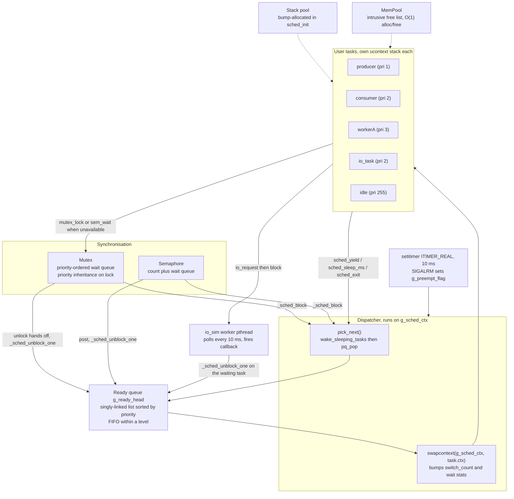
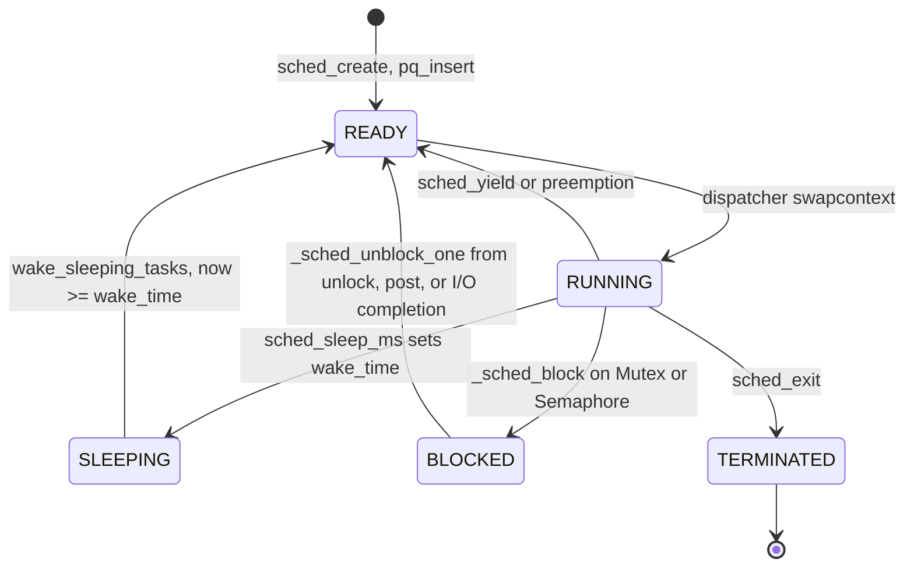

# MicroSched

A preemptive, priority-driven task scheduler written in C that simulates the core mechanics of a real-time operating system (RTOS).  It implements context switching via POSIX `ucontext`, timer-based preemption via `SIGALRM`, mutex/semaphore synchronisation primitives with priority inheritance, a fixed-block memory pool, and a simulated interrupt-driven I/O subsystem.

---

## Architecture



Task state transitions:



### Dispatch over time



### Scheduler Loop

1. `sched_run()` creates a dedicated *dispatcher* context and calls `setcontext` into it.
2. The dispatcher calls `pick_next()` which wakes any sleeping tasks whose deadline has passed and pops the highest-priority task from the ready queue.
3. `swapcontext(&g_sched_ctx, &task->ctx)` transfers control to the task.
4. The task runs until it voluntarily calls `sched_yield()`, `sched_sleep_ms()`, blocks on a mutex/semaphore, or its 10 ms time slice expires via `SIGALRM`.
5. Any of those paths ends with `swapcontext(&task->ctx, &g_sched_ctx)` returning to the dispatcher.

### Priority Queue

The ready queue is a singly-linked list kept sorted by `Task.priority` (0 = highest).  Insertion is O(N) in the number of ready tasks; pop is O(1).  Within the same priority level tasks are served FIFO.

### Context Switch Mechanism

`ucontext_t` is used because it provides a clean, stack-per-task model with a simple `makecontext` / `swapcontext` API.  `setjmp`/`longjmp` was considered but does not carry the stack pointer, making it unsuitable for symmetric context switches between arbitrary tasks.

---

## Synchronisation Primitives

### Mutex

```c
Mutex m;
mutex_init(&m);
mutex_lock(&m);   // blocks if held; raises owner priority if caller has higher priority
mutex_unlock(&m); // restores owner's base priority; wakes highest-priority waiter
mutex_trylock(&m); // non-blocking; returns 1 on success
```

**Priority Inheritance Rationale:** Without inheritance, a low-priority task holding a mutex can be preempted by medium-priority tasks, keeping the high-priority waiter blocked indefinitely (priority inversion).  When a higher-priority task blocks on a mutex, the owner's effective priority is temporarily raised to match the waiter's, ensuring it is scheduled ahead of medium-priority tasks and releases the lock sooner.

### Semaphore

```c
Semaphore s;
sem_init(&s, initial_count);
sem_wait(&s);   // decrement; block if count == 0
sem_post(&s);   // increment; wake highest-priority waiter
sem_trywait(&s); // non-blocking; returns 1 on success
```

---

## Memory Pool

```c
uint8_t buf[4096];
MemPool pool;
pool_init(&pool, buf, 64 /*block_size*/, 64 /*count*/);
void *p = pool_alloc(&pool);   // O(1)
pool_free(&pool, p);            // O(1)
```

Free blocks form an intrusive linked list; the next-pointer is stored in the first `sizeof(void*)` bytes of each free block.  Allocation and deallocation are both O(1).

---

## Simulated I/O

```c
io_sim_init();
io_request(IO_NETWORK, 200 /*ms*/, my_callback, user_data);
// calling task blocks for ~200 ms; callback fires just before unblock
```

A background POSIX thread polls outstanding requests every 10 ms, decrements their latency counter, and calls `_sched_unblock_one()` on the waiting task when the counter reaches zero.

---

## Demo Output (example)

```
=== MicroSched Demo ===
Running 5 tasks for 5 seconds.

[producer] produced item 0  (t=+1ms)
[io_task]  submitting I/O request #0  (t=+2ms)
[consumer] consumed item 0  (t=+3ms)
[workerA]  critical section enter (iter=0, t=+5ms)
[workerA]  critical section exit  (iter=0)
[producer] produced item 1  (t=+82ms)
[io_task]  I/O completion callback fired
[io_task]  I/O request #0 completed
...

[watchdog] 5-second demo complete — stopping all tasks

========= Scheduler Statistics =========
Total context switches: 847

Task                    Pri Switches     Wait(ms)      State
----                    --- --------     --------      -----
idle                    255       12            0  TERMINATED
producer                  1      63          312       READY
consumer                  2      34          891       READY
workerA                   3      41          203       READY
workerB                   4      25          418       READY
io_task                   2      24         1820       READY
watchdog                  0        1            0  TERMINATED
=========================================
```

---

## Build & Run

### Requirements

- GCC or Clang with C11 support
- CMake >= 3.14
- Linux (requires `ucontext`, `SIGALRM`, `setitimer`)

### Build

```bash
cmake -B build -DCMAKE_BUILD_TYPE=Debug
cmake --build build
```

### Run Demo

```bash
./build/micro_sched_demo
```

### Run Tests

```bash
cd build && ctest --output-on-failure
# or directly:
./build/test_scheduler
```

---

## Design Decisions

| Decision | Choice | Rationale |
|----------|--------|-----------|
| Context switch | `ucontext_t` | Full stack isolation; `swapcontext` is symmetric and preserves all registers |
| Preemption | `SIGALRM` + `setitimer` | Portable on Linux/macOS; simulates hardware timer interrupt |
| Time slice | 10 ms | Matches typical RTOS quantum; easily tunable via `TIME_SLICE_MS` |
| Priority model | 0 = highest | Matches POSIX `sched_priority` convention for real-time classes |
| Priority inheritance | Always-on | Prevents priority inversion without API changes |
| Memory pool | Intrusive free list | Zero external metadata; O(1) alloc/free; deterministic (RTOS requirement) |
| I/O simulation | Background thread | Clean separation; real RTOS would use DMA completion IRQs |
